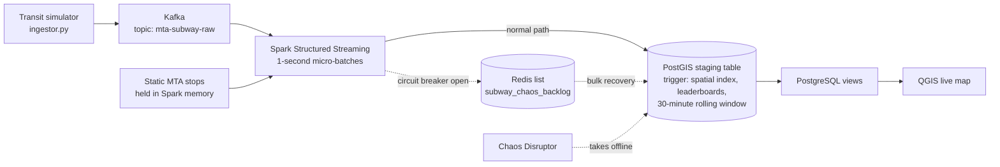

# NYC Transit Chaos: Real-Time Self-Healing Spatial Pipeline

A streaming pipeline that ingests and tracks MTA subway events in real time, enriches them with station locations, and keeps running when its database goes down. A circuit breaker diverts events to Redis during an outage and a bulk recovery replays them into PostGIS afterwards.

## What and why

Live transit data never stops arriving, but databases sometimes do. If the database goes offline, a typical streaming job either stalls or drops events. This project is built to survive that: it separates ingestion, enrichment, buffering and serving, so a database failure only affects the last step. A "Chaos Disruptor" takes PostGIS offline on purpose to prove it.

## Architecture

- **Ingestion:** `ingestor.py` replays MTA subway event payloads into the Kafka topic `mta-subway-raw`.
- **Processing:** Spark Structured Streaming reads the topic in strict 1-second micro-batches.
- **Enrichment without the database:** the static stops table is loaded once at startup and held in Spark's memory, so enrichment never queries PostGIS and an outage cannot stall the stream.
- **Spatial database:** rows land in a PostGIS staging table. A database trigger handles the spatial indexing, updates the proximity leaderboards and removes data older than 30 minutes.
- **Circuit breaker:** if PostGIS is unreachable, Spark catches the connection timeout, trips the breaker and writes the serialized rows to a Redis FIFO list (`subway_chaos_backlog`) instead of failing. When the database returns, the backlog is bulk-loaded back in order.
- **Visualization:** QGIS shows live train positions on a New York map through continuously refreshed PostgreSQL views.

## Tech stack

Python, Apache Kafka, Spark Structured Streaming, PostgreSQL + PostGIS, Redis, QGIS.

## Getting started

<!-- TODO: replace the placeholders with your real commands and variable names -->

1. Start the services: `<your start command>`
2. Start the simulator: `python ingestor.py`
3. Start the Spark streaming job: `<your spark-submit command>`
4. Connect QGIS to the PostGIS database and open the live views.
5. Run the Chaos Disruptor: `<your command>`, then watch the backlog grow in Redis and drain after recovery.
